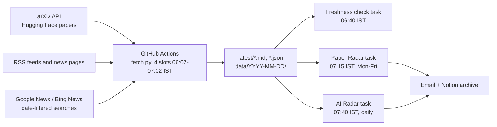

# radar-feeds

[](https://github.com/RKarthik-AI-Labs/radar-feeds/actions/workflows/fetch.yml)
[](LICENSE)

A free GitHub Actions job that collects new arXiv papers and date-filtered AI and search news every morning, and writes them as plain Markdown and JSON files in this repo. Point an AI assistant at those files and it can write a digest from material that is actually new.

Built and run by [RKarthik AI Labs](https://rkarthik.in). The story behind it, what it caught and what it costs: [build log](https://rkarthik.in/ai-labs/radar-feeds/). Want it for your own topics? Go to [Fork it for your own topics](#fork-it-for-your-own-topics).

I use it to feed two research digests:

- **AI Radar** (daily): AI search, AEO/GEO, model launches, AI crawlers, agent traffic, ads in AI answers, B2B buyer AI.
- **Paper Radar** (weekdays): academic and arXiv papers on generative engine optimization, LLM citation and source selection, query fan-out, web agents and related topics.

The two digests are written by scheduled Claude tasks that read these files first.

## Why this exists

The scheduled Claude tasks run in a sandbox that cannot reach arxiv.org, most news sites or RSS feeds, and their web search has no date filter. In practice that meant thin paper coverage and news digests padded with week-old items. That is what I saw in my setup; test your own before you assume it holds for yours. GitHub's runners have open internet access, so they do the collecting, and the digests only need to download a few files from `raw.githubusercontent.com`.



## Fork it for your own topics

1. **Fork the repo.** GitHub disables scheduled workflows on a fork by default. Open the Actions tab and click the button to enable workflows.
2. **Allow commits.** Settings → Actions → General → Workflow permissions → "Read and write permissions" → Save. The job commits its output back to your repo.
3. **Change what is mine.** Do this before the first run:

   | File | What to change |
   |---|---|
   | `.github/workflows/fetch.yml` | The `git config user.name`, `user.email` and the `Co-authored-by` line in the "Commit results" step. Left alone, your fork commits under my identity. |
   | `.github/workflows/fetch.yml` | The four `cron` lines. They are UTC. Set them to finish a little before your digest runs. |
   | `fetch.py` | The `UA` string near the top. Point it at your fork. |
   | `sources.yaml` | `topics`, `feeds` and `news_searches` to your subject. The `mentions` queries contain my name and brand. |
   | `README.md` | The badge and raw URLs, if you keep this file. |

4. **Run it once.** Actions → "Fetch radar feeds" → Run workflow → `all`. It takes about 4 minutes. Open `latest/status.md` and check which sources worked.
5. **Point your assistant at the files** ([next section](#wiring-it-to-an-ai-assistant)).

Your fork starts with my output files and my first-seen ledger. They stop mattering once your own runs replace `latest/`, and the 21-day pruning clears old dated folders. To start clean, delete `data/` and `latest/`. Keep `state/seen.json`, or your first digest will flag everything as new.

**News only, no arXiv.** The news half works on its own. In `fetch.yml`, change `|| 'all'` to `|| 'news'` in the "Fetch papers and news" step, and point your assistant at `news.md` only. You can also run `python fetch.py news` locally.

## Wiring it to an AI assistant

Any assistant that can read a public URL works. Use the raw URLs of your fork:

```
https://raw.githubusercontent.com/<you>/radar-feeds/main/latest/news.md
https://raw.githubusercontent.com/<you>/radar-feeds/main/latest/papers.md
https://raw.githubusercontent.com/<you>/radar-feeds/main/latest/status.md
```

`news.md` and `papers.md` carry a `Generated YYYY-MM-DD HH:MM UTC` line near the top. `status.md` carries a `Started` line. The JSON files have a `generated_utc` field.

Run a freshness check as its own scheduled task, separate from the digest. Stale data is the usual failure, and a digest built from stale files reads exactly like a good one.

An example prompt to adapt:

```
Fetch the three files above. Read the Generated line in news.md and papers.md.
If either is more than 24 hours old, start your reply with "Fetch file stale"
and name the file. Then write a digest of the items marked NEW, grouped by the
headings in the file. Link each item to the URL given in the file. Do not add
items from memory.
```

## Daily schedule

| IST | UTC | What happens |
|---|---|---|
| 06:07 | 00:37 | Fetch slot 1: arXiv announcement (US daylight time) and overnight news |
| 06:22 | 00:52 | Fetch slot 2: backup for slot 1 |
| 06:40 | 01:10 | Freshness-check task reads the `Generated` lines in `latest/` |
| 06:47 | 01:17 | Fetch slot 3: arXiv announcement (US standard time) and anything earlier slots missed |
| 07:02 | 01:32 | Fetch slot 4: backup for slot 3 |
| 07:15 | 01:45 | Paper Radar reads `latest/papers.md` (Monday to Friday) |
| 07:40 | 02:10 | AI Radar reads `latest/news.md` |

arXiv announces new papers Sunday to Thursday at 20:00 US Eastern, so weekday mornings in India get a fresh batch. The two US time zones are why there are two pairs of slots.

GitHub's scheduler is best-effort. On 29 Oct both original slots started about 6 hours late, and on 30 Oct neither ran before 01:55 UTC. Slots 2 and 4 exist to raise the odds that one run lands on time. Extra runs are harmless because `state/seen.json` dedupes. Check the `Generated` line at the top of each file; the digests do, and say "Fetch file stale" in their run notes when it is old.

## Output files

All files are public. Base URL: `https://raw.githubusercontent.com/RKarthik-AI-Labs/radar-feeds/main/`

| File | What it holds | Read by |
|---|---|---|
| `latest/papers.md` | New arXiv papers matching the topics, highest score first, with abstracts. Then other new cs.IR titles, then papers already listed on an earlier day. | Paper Radar, AI Radar (papers bucket) |
| `latest/news.md` | News from the last 30 hours or first seen in the last 18 hours, grouped by priority topic, then by source feed. Each item appears once. | AI Radar |
| `latest/status.md` | Which sources worked, how many items each returned, and the error for any that failed. | Both, and you |
| `latest/papers.json`, `latest/news.json` | The same data in structured form. news.json keeps the full 3-day window with snippets. | Scripts, debugging |
| `data/fulltext/<arxiv id>.txt` | Full text of top new papers, **only for papers whose license allows redistribution** (CC BY, CC BY-SA, CC0). | Paper Radar |
| `data/YYYY-MM-DD/` | Dated copy of the `latest/` files, kept for 21 days. | History |
| `state/seen.json` | First-seen ledger used to mark items as NEW. Do not edit by hand. | fetch.py |

### How to read the files

- **NEW** means the fetcher first saw the item in the last 18 hours. That covers all the morning slots but not the previous day. It does not mean "published today"; check the date on the line.
- **"(already listed on an earlier day)"** marks news items the digests have probably covered before.
- **Topic tags and scores are keyword matches, not judgments.** They decide what gets listed first. The digest tasks decide what matters.
- **Google News links are redirects.** The digests open the story by searching its headline. Bing News links point to the publisher directly.
- **"Full text: not stored"** means the paper's license does not allow republishing it. Read it on its arXiv page.

## What gets collected

**Papers**
- arXiv: every new paper in cs.IR, plus papers from cs.CL, cs.AI, cs.HC, cs.CY, cs.SI and cs.CR that match the topics.
- arXiv searches across all categories for exact phrases such as "generative engine optimization", "AI overviews", "query fan-out" and "robots.txt".
- Hugging Face daily papers that match the topics.

**News feeds** (about 25: 24 at the time of writing, 20 RSS or Atom feeds and 4 sites scraped for links because they have no feed)
- Labs: OpenAI, Anthropic, Google DeepMind, Google AI and Gemini blogs, Google Developers, Mistral, xAI, Qwen, Microsoft, Simon Willison, Techmeme.
- Search engines: Google Search Central, Google Search Status Dashboard, Google Search and Ads blogs, Bing Webmaster and Bing Search blogs.
- Search press: Search Engine Roundtable, Search Engine Journal, PPC Land.
- Agents and crawlers: Cloudflare blog. Tools and B2B: TechCrunch AI, Forrester press releases.

**Date-filtered news searches** (Google News RSS and Bing News RSS, last 2 days)
- One group per topic: Query fan-out, Agents, Crawl, Ads, Search/AEO/GEO, Labs, B2B, and mentions of Karthik Ramachandiran.
- `site:` searches for sites that block GitHub's servers or need JavaScript: Search Engine Land, HUMAN Security, DataDome, Gartner, Meta AI, Perplexity, DeepSeek.
- A relevance filter drops hits whose headline or snippet does not contain the query's phrases. Bing ignores quoted phrases, so without this filter you get sports and celebrity news.

The full list lives in [`sources.yaml`](sources.yaml).

## Changing what gets collected

Edit `sources.yaml` on GitHub (pencil icon) and commit. Any change to `sources.yaml`, `fetch.py`, `requirements.txt` or the workflow starts a fresh run. Check `latest/status.md` about 5 minutes later.

**Add an RSS feed**

```yaml
feeds:
  - {name: Example Blog, type: rss, url: 'https://example.com/feed.xml', site: 'https://example.com/blog/', bucket: seo_press}
```

`site` is a fallback: if the feed URL stops working, the job looks for a feed link on that page and notes it in `status.md`. Buckets are `labs`, `search`, `seo_press`, `agents_crawl`, `tools` and `b2b`.

**Add a site that has no feed**

```yaml
  - {name: Example News, type: html, site: 'https://example.com/news', link_pattern: '^/news/[a-z0-9-]+$', bucket: labs}
```

`link_pattern` is a regular expression matched against link paths on the page. Sites that build their pages with JavaScript return nothing. Use a `site:` search instead (next example).

**Add a news search**

```yaml
news_searches:
  queries:
    crawl:
      - '"AI scraping" lawsuit'
    sitewatch:
      - 'site:example.com'
```

Quote exact phrases. Without OR, a hit must contain all quoted phrases plus at least one other word from the query. With OR, any one phrase is enough.

**Add or tune a topic**

Each topic under `topics:` has a label, a weight and regex patterns. A title match counts double. Non-cs.IR papers need a total score of at least `min_score_non_core` (default 6) to be kept, so a single generic match won't pull in a paper. Keep broad words like "fan-out" next to a qualifier ("query fan-out"); otherwise they match unrelated fields.

**Change the schedule**

Edit the four `cron` lines in [`.github/workflows/fetch.yml`](.github/workflows/fetch.yml). Times are UTC (IST minus 5:30). Odd minutes avoid GitHub's busiest start times. If you move the fetch later, move the digest tasks too.

## Running it

**On GitHub:** Actions → "Fetch radar feeds" → Run workflow. Choose `all`, `papers` or `news`.

**Locally:**

```bash
pip install -r requirements.txt
python fetch.py          # or: python fetch.py papers / python fetch.py news
```

A local run updates `latest/`, `data/` and `state/seen.json` in your checkout. Don't commit those files from a local run; the scheduled job owns them.

## Troubleshooting

| Symptom | Likely cause | Fix |
|---|---|---|
| A source shows HTTP 403 in `status.md` | The site blocks GitHub's servers | Remove the feed and add a `site:` query under `sitewatch` |
| A feed works but notes "used discovered feed …" | The configured URL moved | Copy the discovered URL into `sources.yaml` |
| A page source returns 0 items | The page is built with JavaScript, or `link_pattern` no longer matches | Switch to a `site:` query, or fix the pattern |
| The run succeeded but nothing was committed | The workflow has no write access | Settings → Actions → General → Workflow permissions → "Read and write permissions" |
| A fork never runs on schedule | GitHub disables scheduled workflows on forks by default | Actions tab → enable workflows |
| Runs stopped after weeks of working | GitHub disables scheduled workflows in a public repo after 60 days with no repository activity | Actions tab → re-enable the workflow, or push any commit to `main` |
| The digest says "Fetch file stale" | GitHub started the job late, or it failed | Check the Actions tab. Run it manually if needed. |
| A pushed change didn't start a run | Force pushes may not trigger path-filtered workflows | Run the workflow manually |
| Lots of off-topic news under a topic | The query is too loose | Quote the key phrase, or add a qualifying word |
| A known paper is missing | Not in the listed categories, or its score was below the threshold | Add an arXiv search under `arxiv_queries`, or a pattern to the topic |

## Limitations

- **It is a morning batch, not a live feed.** News searches look back 2 days and the job runs a few times each morning. Anything published after the last slot waits for the next day.
- **Scoring is keyword matching.** Topic tags come from regex patterns and weights in `sources.yaml`. A paper can be on topic and score zero, or off topic and score high. The digest step has to judge relevance.
- **Pages without feeds break quietly.** The four scraped sources depend on a link pattern. When a site changes its markup, the source returns 0 items and `status.md` is the only place that says so.
- **JavaScript-rendered pages return nothing.** The workaround is a `site:` news search, which gives headlines and snippets only.
- **Google News links are redirects**, so you cannot read the publisher URL straight from the file.
- **The scheduler is best-effort.** See the delays logged under [Daily schedule](#daily-schedule). The freshness check exists because of them.
- **arXiv has a 5-day look-back** (`lookback_days`), and non-cs.IR papers below the score threshold are dropped.
- **Full text is stored only for papers with a permissive license.** Everything else links to arXiv.

## Data, licensing and etiquette

- **arXiv metadata and abstracts** are released by arXiv under CC0, so publishing them here is fine.
- **arXiv full texts** are published only when the paper's own license allows redistribution (CC BY, CC BY-SA or CC0). arXiv's API terms prohibit serving other e-prints from your own servers, and this repo is public. Keep `fulltext_allowed_licenses` as it is.
- **arXiv rate limits**: arXiv asks for no more than one request every 3 seconds over a single connection. The job waits 3.5 seconds between arXiv requests. Don't lower `ARXIV_DELAY` in `fetch.py`, and don't run the job in parallel.
- This project is not affiliated with or endorsed by arXiv.
- **News**: the job stores headlines, links, dates and short snippets, and links to the publisher for everything else.
- **Never commit secrets.** This repo is public. Tokens go in Settings → Secrets.

## License

The code and configuration (`fetch.py`, `sources.yaml`, the workflow, this README) are released under the [MIT License](LICENSE). Use them, change them, sell them. Keep the copyright notice.

The MIT license does not cover the generated files in `latest/`, `data/` and `state/`. They contain other people's material: arXiv metadata and abstracts (CC0), paper full texts under each paper's own Creative Commons license, and news headlines and snippets that belong to their publishers. Reuse of that material follows its owners' terms, not mine.

## Repository layout

```
fetch.py                    collector: arXiv, feeds, news searches, scoring, outputs
sources.yaml                everything you configure
requirements.txt            pinned Python dependencies
LICENSE                     MIT, covers the code and config
.github/workflows/fetch.yml schedule and commit step
latest/                     today's files, read by the digests
data/YYYY-MM-DD/            dated copies, 21-day retention
data/fulltext/              redistributable full texts only
state/seen.json             first-seen ledger
```

## Maintainer conventions

These describe how I run my copy. A fork can ignore them.

- Commits are authored by Kiran Kowda with Karthik Ramachandiran as co-author, including the daily data commits from the workflow.
- Data commits are named `data: <IST date> <UTC time>Z`.

## Cost

The collection layer costs nothing. GitHub Actions minutes are free on public repositories with standard runners, and each run takes about 4 minutes. No API keys or tokens are needed.

The digest layer is not free by default. It costs whatever your AI assistant plan costs. In my setup that is scheduled Claude tasks that email the digest and archive it to Notion.
