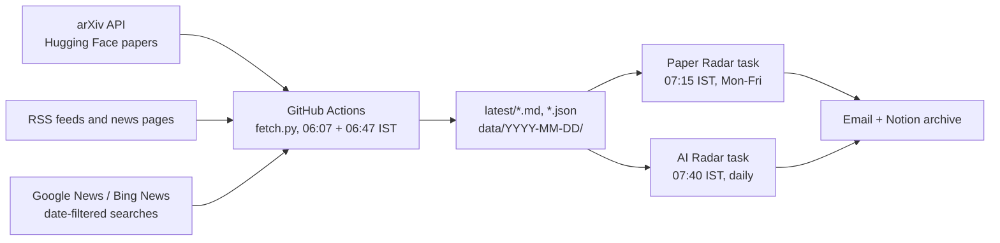

# radar-feeds

[](https://github.com/RKarthik-AI-Labs/radar-feeds/actions/workflows/fetch.yml)

A daily collection job for two research digests run by [RKarthik AI Labs](https://rkarthik.in):

- **AI Radar** (daily): AI search, AEO/GEO, model launches, AI crawlers, agent traffic, ads in AI answers, B2B buyer AI.
- **Paper Radar** (weekdays): academic and arXiv papers on generative engine optimization, LLM citation and source selection, query fan-out, web agents and related topics.

Every morning a GitHub Actions job pulls new arXiv papers, about 25 news feeds and a set of date-filtered news searches. It writes them as plain Markdown and JSON files in this repo. The two digests are written by scheduled Claude tasks that read these files first.

## Why this exists

The scheduled Claude tasks run in a sandbox that cannot reach arxiv.org, most news sites or RSS feeds, and their web search has no date filter. In practice that meant thin paper coverage and news digests padded with week-old items. GitHub's runners have open internet access, so they do the collecting, and the digests only need to download a few files from `raw.githubusercontent.com`.



## Daily schedule

| IST | UTC | What happens |
|---|---|---|
| 06:07 | 00:37 | Fetch run 1: arXiv announcement (US daylight time) and overnight news |
| 06:47 | 01:17 | Fetch run 2: arXiv announcement (US standard time) and anything run 1 missed |
| 07:15 | 01:45 | Paper Radar reads `latest/papers.md` (Monday to Friday) |
| 07:40 | 02:10 | AI Radar reads `latest/news.md` |

arXiv announces new papers Sunday to Thursday at 20:00 US Eastern, so weekday mornings in India get a fresh batch. GitHub can start scheduled jobs 10 to 30 minutes late when its queue is busy. Check the `Generated` line at the top of each file; the digests do, and say "Fetch file stale" in their run notes when it is old.

## Output files

All files are public. Base URL: `https://raw.githubusercontent.com/RKarthik-AI-Labs/radar-feeds/main/`

| File | What it holds | Read by |
|---|---|---|
| `latest/papers.md` | New arXiv papers matching the topics, highest score first, with abstracts. Then other new cs.IR titles, then papers already listed on an earlier day. | Paper Radar, AI Radar (papers bucket) |
| `latest/news.md` | News from the last 30 hours or first seen in the last 18 hours, grouped by priority topic, then by source feed. Each item appears once. | AI Radar |
| `latest/status.md` | Which sources worked, how many items each returned, and the error for any that failed. | Both, and you |
| `latest/papers.json`, `latest/news.json` | The same data in structured form. news.json keeps the full 3-day window with snippets. | Scripts, debugging |
| `data/fulltext/<arxiv id>.txt` | Full text of top new papers, **only for papers whose license allows redistribution** (CC BY, CC BY-SA, CC0). | Paper Radar |
| `data/YYYY-MM-DD/` | Dated copy of the `latest/` files, kept for 21 days. | History |
| `state/seen.json` | First-seen ledger used to mark items as NEW. Do not edit by hand. | fetch.py |

### How to read the files

- **NEW** means the fetcher first saw the item in the last 18 hours. That covers both morning runs but not the previous day. It does not mean "published today"; check the date on the line.
- **"(already listed on an earlier day)"** marks news items the digests have probably covered before.
- **Topic tags and scores are keyword matches, not judgments.** They decide what gets listed first. The digest tasks decide what matters.
- **Google News links are redirects.** The digests open the story by searching its headline. Bing News links point to the publisher directly.
- **"Full text: not stored"** means the paper's license does not allow republishing it. Read it on its arXiv page.

## What gets collected

**Papers**
- arXiv: every new paper in cs.IR, plus papers from cs.CL, cs.AI, cs.HC, cs.CY, cs.SI and cs.CR that match the topics.
- arXiv searches across all categories for exact phrases such as "generative engine optimization", "AI overviews", "query fan-out" and "robots.txt".
- Hugging Face daily papers that match the topics.

**News feeds** (RSS, or link scraping where a site has no feed)
- Labs: OpenAI, Anthropic, Google DeepMind, Google AI and Gemini blogs, Google Developers, Mistral, xAI, Qwen, Microsoft, Simon Willison, Techmeme.
- Search engines: Google Search Central, Google Search Status Dashboard, Google Search and Ads blogs, Bing Webmaster and Bing Search blogs.
- Search press: Search Engine Roundtable, Search Engine Journal, PPC Land.
- Agents and crawlers: Cloudflare blog. Tools and B2B: TechCrunch AI, Forrester press releases.

**Date-filtered news searches** (Google News RSS and Bing News RSS, last 2 days)
- One group per topic: Query fan-out, Agents, Crawl, Ads, Search/AEO/GEO, Labs, B2B, and mentions of Karthik Ramachandiran.
- `site:` searches for sites that block GitHub's servers or need JavaScript: Search Engine Land, HUMAN Security, DataDome, Gartner, Meta AI, Perplexity, DeepSeek.
- A relevance filter drops hits whose headline or snippet does not contain the query's phrases. Bing ignores quoted phrases, so without this filter you get sports and celebrity news.

The full list lives in [`sources.yaml`](sources.yaml).

## Changing what gets collected

Edit `sources.yaml` on GitHub (pencil icon) and commit. Any change to `sources.yaml`, `fetch.py`, `requirements.txt` or the workflow starts a fresh run. Check `latest/status.md` about 5 minutes later.

**Add an RSS feed**

```yaml
feeds:
  - {name: Example Blog, type: rss, url: 'https://example.com/feed.xml', site: 'https://example.com/blog/', bucket: seo_press}
```

`site` is a fallback: if the feed URL stops working, the job looks for a feed link on that page and notes it in `status.md`. Buckets are `labs`, `search`, `seo_press`, `agents_crawl`, `tools` and `b2b`.

**Add a site that has no feed**

```yaml
  - {name: Example News, type: html, site: 'https://example.com/news', link_pattern: '^/news/[a-z0-9-]+$', bucket: labs}
```

`link_pattern` is a regular expression matched against link paths on the page. Sites that build their pages with JavaScript return nothing. Use a `site:` search instead (next example).

**Add a news search**

```yaml
news_searches:
  queries:
    crawl:
      - '"AI scraping" lawsuit'
    sitewatch:
      - 'site:example.com'
```

Quote exact phrases. Without OR, a hit must contain all quoted phrases plus at least one other word from the query. With OR, any one phrase is enough.

**Add or tune a topic**

Each topic under `topics:` has a label, a weight and regex patterns. A title match counts double. Non-cs.IR papers need a total score of at least `min_score_non_core` (default 6) to be kept, so a single generic match won't pull in a paper. Keep broad words like "fan-out" next to a qualifier ("query fan-out"); otherwise they match unrelated fields.

**Change the schedule**

Edit the two `cron` lines in [`.github/workflows/fetch.yml`](.github/workflows/fetch.yml). Times are UTC (IST minus 5:30). Odd minutes avoid GitHub's busiest start times. If you move the fetch later, move the digest tasks too.

## Running it

**On GitHub:** Actions → "Fetch radar feeds" → Run workflow. Choose `all`, `papers` or `news`.

**Locally:**

```bash
pip install -r requirements.txt
python fetch.py          # or: python fetch.py papers / python fetch.py news
```

A local run updates `latest/`, `data/` and `state/seen.json` in your checkout. Don't commit those files from a local run; the scheduled job owns them.

## Troubleshooting

| Symptom | Likely cause | Fix |
|---|---|---|
| A source shows HTTP 403 in `status.md` | The site blocks GitHub's servers | Remove the feed and add a `site:` query under `sitewatch` |
| A feed works but notes "used discovered feed …" | The configured URL moved | Copy the discovered URL into `sources.yaml` |
| A page source returns 0 items | The page is built with JavaScript, or `link_pattern` no longer matches | Switch to a `site:` query, or fix the pattern |
| The run succeeded but nothing was committed | The workflow has no write access | Settings → Actions → General → Workflow permissions → "Read and write permissions" |
| The digest says "Fetch file stale" | GitHub started the job late, or it failed | Check the Actions tab. Run it manually if needed. |
| A pushed change didn't start a run | Force pushes may not trigger path-filtered workflows | Run the workflow manually |
| Lots of off-topic news under a topic | The query is too loose | Quote the key phrase, or add a qualifying word |
| A known paper is missing | Not in the listed categories, or its score was below the threshold | Add an arXiv search under `arxiv_queries`, or a pattern to the topic |

## Data, licensing and etiquette

- **arXiv metadata and abstracts** are released by arXiv under CC0, so publishing them here is fine.
- **arXiv full texts** are published only when the paper's own license allows redistribution (CC BY, CC BY-SA or CC0). arXiv's API terms prohibit serving other e-prints from your own servers, and this repo is public. Keep `fulltext_allowed_licenses` as it is.
- **arXiv rate limits**: arXiv asks for no more than one request every 3 seconds over a single connection. The job waits 3.5 seconds between arXiv requests. Don't lower `ARXIV_DELAY` in `fetch.py`, and don't run the job in parallel.
- This project is not affiliated with or endorsed by arXiv.
- **News**: the job stores headlines, links, dates and short snippets, and links to the publisher for everything else.
- **Never commit secrets.** This repo is public. Tokens go in Settings → Secrets.

## Repository layout

```
fetch.py                    collector: arXiv, feeds, news searches, scoring, outputs
sources.yaml                everything you configure
requirements.txt            pinned Python dependencies
.github/workflows/fetch.yml schedule and commit step
latest/                     today's files, read by the digests
data/YYYY-MM-DD/            dated copies, 21-day retention
data/fulltext/              redistributable full texts only
state/seen.json             first-seen ledger
```

## Conventions

- Commits are authored by Kiran Kowda with Karthik Ramachandiran as co-author, including the daily data commits from the workflow.
- Data commits are named `data: <IST date> <UTC time>Z`.

## Cost

GitHub Actions minutes are free on public repositories with standard runners. Each run takes about 4 minutes.
